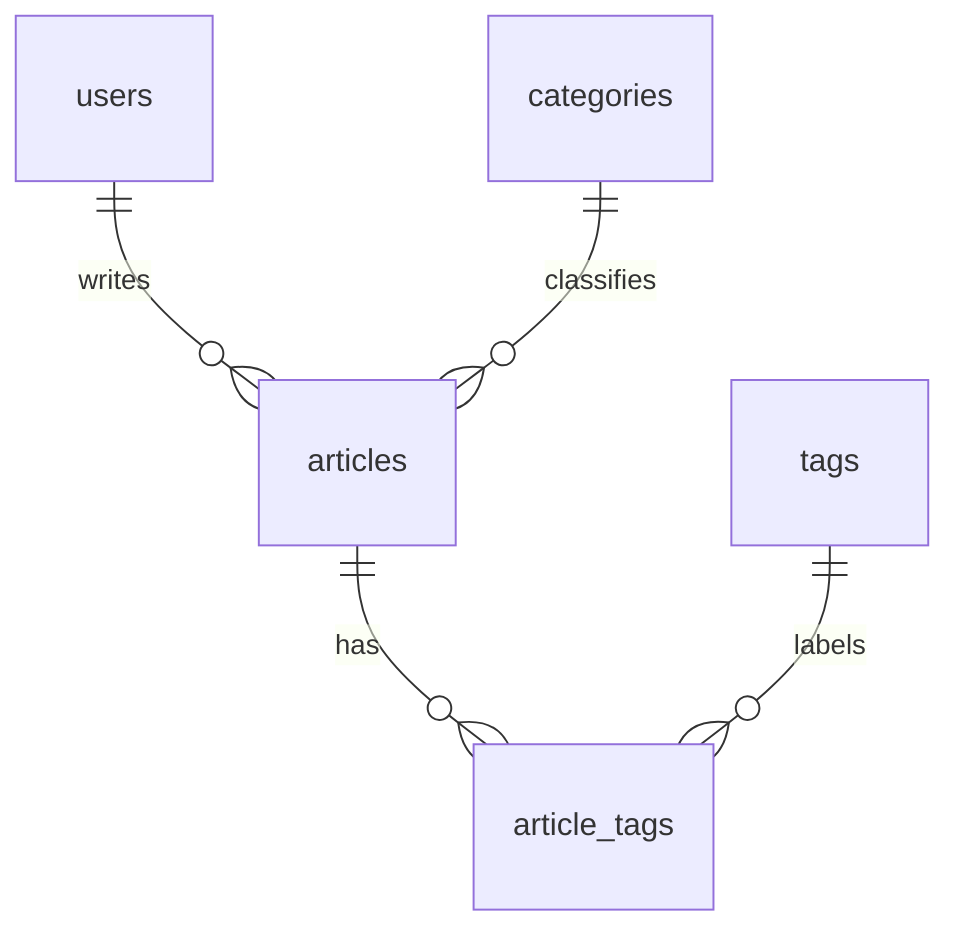

# 个人博客系统 — 产品需求文档（spec.md）

| 项目 | 内容 |
| --- | --- |
| 文档版本 | v1.0 |
| 日期 | 2026-10-31 |
| 状态 | 已确认（已实现） |
| 技术栈 | React + TypeScript + Vite / Node.js + Express / SQLite（Node 内置 `node:sqlite`） / JWT |

---

## 1. 项目概述

构建一个单作者/多用户的轻量级个人博客系统。登录用户可撰写、编辑、删除自己的文章；所有访客可浏览文章列表与详情。系统包含前后端两个独立工程，通过 RESTful API 通信。

### 1.1 目标

- 提供完整的「注册 → 登录 → 写作 → 浏览」闭环。
- 文章内容使用 Markdown 编写，前端渲染为 HTML。
- 列表支持分页、分类筛选、关键词搜索。
- 鉴权使用 JWT，token 有效期 7 天。

### 1.2 非目标（本期不做）

- 评论、点赞、关注、消息通知
- 草稿箱与定时发布（文章发布即公开）
- 富文本编辑器、图片上传服务（封面仅支持填写图片 URL）
- 管理员后台、文章审核、用户封禁
- 第三方登录（OAuth）、邮箱验证、找回密码
- 服务端渲染（SSR）、SEO 优化

---

## 2. 用户角色

| 角色 | 说明 | 权限 |
| --- | --- | --- |
| 游客（未登录） | 未持有有效 token | 浏览文章列表、文章详情、注册、登录 |
| 登录用户 | 持有有效 JWT | 游客权限 + 发布文章、编辑/删除**自己**的文章、查看/编辑个人信息 |

---

## 3. 功能需求

### 3.1 用户与认证

#### FR-A1 注册

- 输入：用户名、邮箱、密码
- 校验规则：
  - 用户名：3–20 字符，仅允许字母、数字、下划线，唯一
  - 邮箱：合法邮箱格式，唯一
  - 密码：6–32 字符，至少包含字母和数字
- 密码使用 bcrypt（cost ≥ 10）哈希后存储，**任何接口都不返回密码字段**
- 成功后直接返回 JWT，前端自动登录并跳转首页
- 失败场景：用户名/邮箱已存在（409）、参数不合法（400）

#### FR-A2 登录

- 输入：邮箱（或用户名）+ 密码
- 校验通过后签发 JWT：
  - 载荷：`{ userId, username }`
  - 有效期：**7 天**
  - 签名算法：HS256，密钥来自环境变量 `JWT_SECRET`
- 返回：`{ token, user }`
- 失败场景：账号不存在或密码错误统一返回 401「邮箱或密码错误」（不区分具体原因）

#### FR-A3 个人中心

- 查看：用户名、邮箱、头像 URL、个人简介、注册时间、文章数
- 编辑：头像 URL、个人简介（≤ 200 字）；用户名与邮箱本期**不可修改**
- 需要登录；仅能操作自己的资料

#### FR-A4 登录态管理（前端）

- token 存储于 `localStorage`，请求时通过 `Authorization: Bearer <token>` 携带
- 应用启动时调用 `GET /api/auth/me` 校验 token，失效则清除本地状态
- 路由守卫：访问 `/write`、`/profile` 未登录时重定向至 `/login`，登录后回跳原页面

---

### 3.2 文章

#### FR-B1 发布文章

- 输入：标题（必填，≤ 100 字）、内容（必填，Markdown）、分类（单选）、标签（多选/自由输入，≤ 5 个）、封面（图片 URL，可空）
- 作者自动取自 token
- 成功后返回文章详情，跳转至详情页
- 校验：标题非空且不超长；内容非空；分类必须存在

#### FR-B2 编辑文章

- 仅作者本人可编辑（服务端校验 `article.user_id === token.userId`，否则 403）
- 可修改全部文章字段（标题、内容、分类、标签、封面）
- 已存在标签复用，新标签自动创建

#### FR-B3 删除文章

- 仅作者本人可删除，否则 403
- 二次确认后执行，物理删除（关联标签关系一并删除）
- 成功后列表页刷新

#### FR-B4 文章详情

- 返回标题、内容（Markdown 原文）、作者信息（用户名、头像）、分类、标签、封面、浏览次数、发布时间
- **每次成功请求浏览次数 +1**（数据库原子自增 `view_count = view_count + 1`），不做防刷/去重
- 不存在时返回 404
- 前端将 Markdown 渲染为 HTML，需做 XSS 过滤（白名单方式）

#### FR-B5 文章列表

- 分页：`page`（默认 1）、`pageSize`（默认 10，上限 50）
- 筛选：`categoryId`
- 搜索：`keyword`，匹配**标题或内容**（`LIKE %keyword%`，不区分大小写）
- 排序：按发布时间倒序
- 返回：列表项（id、标题、摘要、封面、作者名、分类、标签、浏览量、发布时间）+ 分页信息（total、page、pageSize、totalPages）
- 摘要：取 Markdown 正文去掉语法符号后的前 120 字（服务端生成）
- 筛选/搜索条件为空时不参与过滤；无条件组合合法（分页 + 分类 + 关键词可叠加）

#### FR-B6 分类与标签

- 分类：预置/由文章写入时选择，列表接口返回全部分类（含文章数量，可选）
- 标签：文章写入时按名称 upsert；列表接口可返回热门标签（可选，本期前端仅用于筛选展示不作为硬需求）

---

## 4. 数据模型（SQLite）

数据库文件：`server/data/blog.db`（首次启动自动创建，无需安装数据库服务）。使用 Node.js 内置 `node:sqlite`（`DatabaseSync`），开启 WAL 与外键约束。

```sql
PRAGMA foreign_keys = ON;

CREATE TABLE IF NOT EXISTS users (
  id            INTEGER PRIMARY KEY AUTOINCREMENT,
  username      TEXT NOT NULL COLLATE NOCASE UNIQUE,
  email         TEXT NOT NULL COLLATE NOCASE UNIQUE,
  password_hash TEXT NOT NULL,
  avatar_url    TEXT,
  bio           TEXT,
  created_at    TEXT NOT NULL,
  updated_at    TEXT NOT NULL
);

CREATE TABLE IF NOT EXISTS categories (
  id         INTEGER PRIMARY KEY AUTOINCREMENT,
  name       TEXT NOT NULL COLLATE NOCASE UNIQUE,
  created_at TEXT NOT NULL
);

CREATE TABLE IF NOT EXISTS tags (
  id         INTEGER PRIMARY KEY AUTOINCREMENT,
  name       TEXT NOT NULL COLLATE NOCASE UNIQUE,
  created_at TEXT NOT NULL
);

CREATE TABLE IF NOT EXISTS articles (
  id          INTEGER PRIMARY KEY AUTOINCREMENT,
  user_id     INTEGER NOT NULL REFERENCES users (id) ON DELETE CASCADE,
  category_id INTEGER NOT NULL REFERENCES categories (id) ON DELETE RESTRICT,
  title       TEXT NOT NULL,
  content     TEXT NOT NULL,                  -- Markdown 原文
  summary     TEXT NOT NULL DEFAULT '',
  cover_url   TEXT,
  view_count  INTEGER NOT NULL DEFAULT 0,
  created_at  TEXT NOT NULL,
  updated_at  TEXT NOT NULL
);

CREATE INDEX IF NOT EXISTS idx_articles_created  ON articles (created_at);
CREATE INDEX IF NOT EXISTS idx_articles_category ON articles (category_id);
CREATE INDEX IF NOT EXISTS idx_articles_user     ON articles (user_id);

CREATE TABLE IF NOT EXISTS article_tags (
  article_id INTEGER NOT NULL REFERENCES articles (id) ON DELETE CASCADE,
  tag_id     INTEGER NOT NULL REFERENCES tags (id)     ON DELETE CASCADE,
  PRIMARY KEY (article_id, tag_id)
);

CREATE INDEX IF NOT EXISTS idx_article_tags_tag ON article_tags (tag_id);
```

说明：SQLite 无固定列宽，长度限制由应用层 zod 校验；时间统一存 ISO 8601 字符串（`strftime('%Y-%m-%dT%H:%M:%fZ', 'now')`）。建表脚本位于 `server/sql/schema.sql`，服务启动时自动执行（`CREATE TABLE IF NOT EXISTS` 幂等）。

初始化数据：至少预置 3 个分类（技术、生活、随笔），通过 `INSERT OR IGNORE` 写入，重复启动不会产生脏数据。

### 4.1 实体关系



---

## 5. API 设计

### 5.1 约定

- 基础路径：`/api`
- 请求/响应：`application/json`
- 统一响应体：

```json
{ "code": 0, "message": "ok", "data": {} }
```

- `code`：0 成功；非 0 为业务错误码，HTTP 状态码同步表达语义
- 鉴权：需登录的接口必须携带 `Authorization: Bearer <token>`

| HTTP | 业务码 | 含义 |
| --- | --- | --- |
| 400 | 1001 | 参数校验失败 |
| 401 | 1002 | 未登录 / token 失效 |
| 403 | 1003 | 无权限（非作者） |
| 404 | 1004 | 资源不存在 |
| 409 | 1005 | 冲突（用户名/邮箱已存在） |
| 500 | 5000 | 服务器错误 |

### 5.2 接口清单

| 方法 | 路径 | 鉴权 | 说明 |
| --- | --- | --- | --- |
| POST | `/api/auth/register` | 否 | 注册 |
| POST | `/api/auth/login` | 否 | 登录 |
| GET | `/api/auth/me` | 是 | 当前用户信息 |
| PUT | `/api/users/me` | 是 | 更新头像/简介 |
| GET | `/api/categories` | 否 | 分类列表 |
| GET | `/api/articles` | 否 | 文章列表（分页/筛选/搜索） |
| GET | `/api/articles/:id` | 否 | 文章详情（浏览量+1） |
| POST | `/api/articles` | 是 | 发布文章 |
| PUT | `/api/articles/:id` | 是 | 编辑文章（仅作者） |
| DELETE | `/api/articles/:id` | 是 | 删除文章（仅作者） |

### 5.3 关键接口示例

**POST /api/auth/register**

```json
// request
{ "username": "alice", "email": "a@b.com", "password": "abc12345" }
// response
{
  "code": 0, "message": "ok",
  "data": {
    "token": "eyJ...",
    "user": { "id": 1, "username": "alice", "email": "a@b.com", "avatarUrl": null, "bio": null }
  }
}
```

**GET /api/articles?page=1&pageSize=10&categoryId=2&keyword=react**

```json
{
  "code": 0, "message": "ok",
  "data": {
    "list": [
      {
        "id": 1, "title": "React 19 体验", "summary": "……",
        "coverUrl": null, "category": { "id": 2, "name": "技术" },
        "tags": [{ "id": 1, "name": "react" }],
        "author": { "id": 1, "username": "alice", "avatarUrl": null },
        "viewCount": 12, "createdAt": "2026-10-30T10:00:00.000Z"
      }
    ],
    "pagination": { "total": 23, "page": 1, "pageSize": 10, "totalPages": 3 }
  }
}
```

**POST /api/articles**

```json
{ "title": "标题", "content": "# Markdown 正文", "categoryId": 1, "tags": ["react", "vite"], "coverUrl": "https://..." }
```

**PUT /api/users/me**

```json
{ "avatarUrl": "https://...", "bio": "一句话介绍自己" }
```

### 5.4 校验与错误处理

- 使用 `express-validator`（或 zod）在路由层做入参校验
- 全局错误中间件统一输出结构化错误体
- 数据库错误不暴露给前端，仅记录服务端日志

---

## 6. 前端设计

### 6.1 页面与路由

| 路由 | 页面 | 鉴权 | 说明 |
| --- | --- | --- | --- |
| `/` | 首页 / 文章列表 | 否 | 分页、分类筛选、关键词搜索、封面卡片 |
| `/articles/:id` | 文章详情 | 否 | Markdown 渲染、作者信息、编辑/删除入口（仅作者可见） |
| `/write` | 写文章 | 是 | 新建/编辑复用同一表单（`/articles/:id/edit`） |
| `/articles/:id/edit` | 编辑文章 | 是 | 仅作者可见 |
| `/profile` | 个人中心 | 是 | 展示资料 + 我的文章列表 + 编辑资料 |
| `/login` | 登录 | 否 | 登录后回跳 |
| `/register` | 注册 | 否 | 注册后自动登录 |
| `*` | 404 页 | 否 | — |

### 6.2 组件与状态

- 路由：`react-router-dom` v6
- 服务端状态：`@tanstack/react-query`（列表缓存、失效刷新）
- 表单：`react-hook-form` + 校验（复用与后端一致的规则）
- HTTP 客户端：`axios`，请求拦截器注入 token，响应拦截器统一处理 401（清除 token 并跳转登录）
- Markdown：`react-markdown` + `remark-gfm`，禁止原生 HTML 渲染（默认即安全），链接加 `rel="noopener"`
- 样式：CSS Modules 或 Tailwind（实现阶段二选一，见 §10）
- 全局登录态：`AuthContext`（user、token、login、logout）

### 6.3 交互与状态设计

- 列表页：加载骨架屏；空状态「暂无文章」；搜索防抖 300ms
- 表单页：提交按钮 loading 态、错误提示就近展示；未保存离开时确认（可选）
- 详情页：作者本人可见「编辑 / 删除」；删除弹二次确认
- 全站：统一的 Toast 提示成功/失败
- 响应式：≥ 768px 双栏/卡片布局，移动端单列

### 6.4 前端目录结构

```
client/
├─ src/
│  ├─ api/            # axios 实例与各资源请求封装
│  ├─ components/     # 通用组件（ArticleCard、Pagination、MarkdownView 等）
│  ├─ pages/          # Home、ArticleDetail、Editor、Profile、Login、Register
│  ├─ hooks/          # useAuth、useArticles 等
│  ├─ context/        # AuthContext
│  ├─ types/          # 与后端一致的 TS 类型定义
│  ├─ utils/
│  ├─ App.tsx
│  └─ main.tsx
├─ index.html
└─ vite.config.ts
```

### 6.5 后端目录结构

```
server/
├─ src/
│  ├─ config/         # 环境变量、数据库连接池
│  ├─ middleware/     # auth、errorHandler、validate
│  ├─ routes/         # auth、users、articles、categories
│  ├─ controllers/
│  ├─ services/       # 业务逻辑（文章 CRUD、标签 upsert、浏览量自增）
│  ├─ repositories/   # SQL 查询（可选，按复杂度决定是否拆分）
│  ├─ types/
│  ├─ app.ts
│  └─ server.ts
├─ sql/schema.sql
└─ package.json
```

---

## 7. 非功能与安全要求

- **密码**：bcrypt 哈希，永不出现在响应或日志中
- **JWT**：7 天有效；密钥仅从环境变量读取；前端仅存 `localStorage`
- **SQL 注入**：全部使用参数化查询（`node:sqlite` 的 `prepare(...).get/all/run` 绑定参数），禁止字符串拼接 SQL
- **XSS**：Markdown 渲染不使用 `dangerouslySetInnerHTML` 渲染用户 HTML
- **CORS**：仅允许 `CLIENT_ORIGIN` 环境变量指定的来源
- **输入长度**：标题 100、简介 200、标签名 30、URL 500，超长返回 400
- **分页上限**：`pageSize ≤ 50`，防止大查询
- **环境变量**：全部可选，不配置也能启动。`.env.example` 提供 `PORT`（默认 4000）、`DB_FILE`（默认 `server/data/blog.db`）、`JWT_SECRET`、`CLIENT_ORIGIN`
- **错误日志**：服务端统一日志格式，不把堆栈返回给客户端

---

## 8. 验收标准（Definition of Done）

### 8.1 认证

- [ ] 新用户可用合法信息注册成功，并自动登录进入首页
- [ ] 重复用户名 / 重复邮箱注册返回 409，且提示明确
- [ ] 密码错误提示统一为「邮箱或密码错误」
- [ ] 登录后 7 天内刷新页面仍保持登录态；token 过期后自动跳转登录
- [ ] 未登录访问 `/write`、`/profile` 被重定向至 `/login`，登录后回到原目标页

### 8.2 文章

- [ ] 登录用户可发布文章，详情页正确渲染 Markdown（含代码块、表格、图片）
- [ ] 非作者打开他人文章详情看不到编辑/删除按钮；直接调用编辑/删除接口返回 403
- [ ] 编辑保存后详情页立即展示新内容
- [ ] 删除后列表不再出现该文章，关联标签关系被清理
- [ ] 每次打开详情页浏览量 +1，刷新后数值持续增长
- [ ] 列表分页切换正确，`totalPages` 与总数一致
- [ ] 分类筛选、关键词搜索可叠加且结果准确（标题/内容均命中）
- [ ] `pageSize=100` 请求被拒绝或按上限 50 处理

### 8.3 个人中心

- [ ] 可查看本人资料与文章数量
- [ ] 可修改头像 URL 与简介，刷新后仍生效；简介超 200 字被拒绝
- [ ] 越权修改他人资料无接口可用（仅 `/users/me`）

### 8.4 工程与质量

- [ ] `npm run build` 前端无 TS 类型错误
- [ ] 后端所有路由有入参校验与统一错误处理
- [ ] 数据库零配置：`npm install` + `npm run dev` 后自动创建 SQLite 文件、执行 `sql/schema.sql` 建表并写入预置分类
- [ ] README 说明本地启动步骤（后端、前端两个进程，无需安装数据库）

---

## 9. 开发计划（实现顺序）

1. **脚手架与基础**：初始化 `client` / `server`，配置 TS、ESLint、环境变量、数据库连接
2. **数据库**：建表 SQL、分类种子数据、连接池
3. **认证后端**：注册/登录/me、JWT 中间件、统一错误处理
4. **文章后端**：CRUD、标签 upsert、列表分页筛选搜索、浏览量自增
5. **前端基础**：路由、Axios 封装、AuthContext、登录/注册页
6. **前端文章**：列表页、详情页（Markdown 渲染）、编辑器（新建/编辑）
7. **个人中心**：资料展示与编辑、我的文章
8. **收尾**：Toast、空态/加载态、响应式、README、逐条走查 §8 验收

---

## 10. 待确认事项（请评审时给出结论）

1. **样式方案**：Tailwind CSS（开发快、内联样式多）还是 CSS Modules（零额外依赖、可控性强）？默认建议 Tailwind。
2. **分类来源**：分类由文章写入时从预置列表选择即可，是否需要「用户自定义新建分类」？默认**不需要**。
3. **个人中心「我的文章」**：是否需要在列表接口额外支持 `authorId` 过滤（用于展示本人文章）？默认**需要**（新增可选查询参数 `authorId`）。
4. **封面**：本期仅支持图片 URL 输入，是否可接受？（不做文件上传）
5. **是否保留草稿状态**：默认**不做**，发布即公开。
6. **部署范围**：本期仅本地开发运行，是否需要 Docker / 部署脚本？默认**不需要**。

---

*文档结束。确认以上内容（尤其是 §10 的六项）后即可进入编码阶段。*
